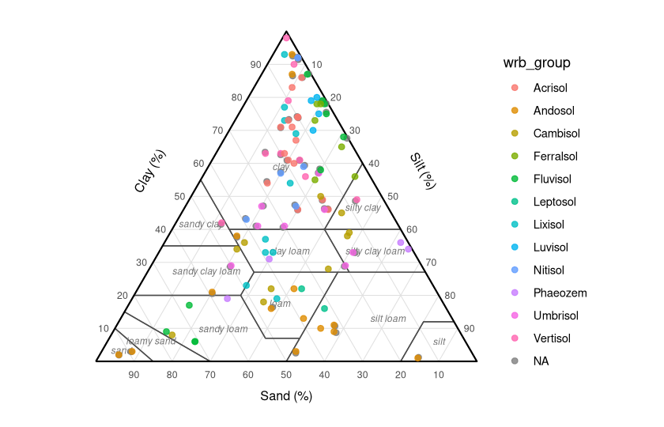
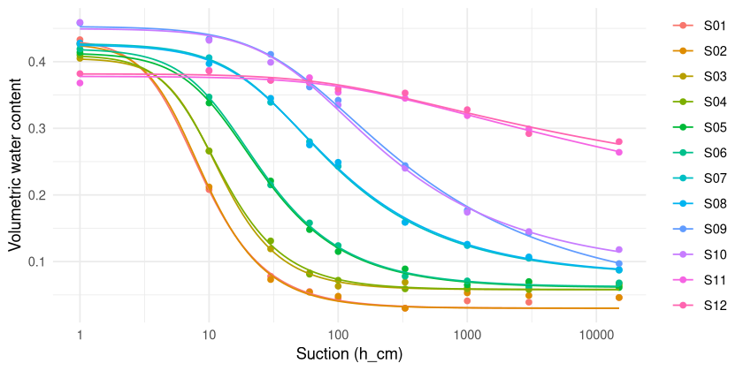

<!-- README.md is generated from README.Rmd. Please edit that file -->

# tidysoilr

<!-- badges: start -->
[](https://github.com/jmozez/tidysoilr/actions/workflows/R-CMD-check.yaml)
[](https://github.com/jmozez/tidysoilr/actions/workflows/lint.yaml)
[](https://github.com/jmozez/tidysoilr/actions/workflows/vercel.yaml)
[](https://github.com/jmozez/tidysoilr)
[](https://lifecycle.r-lib.org/articles/stages.html#experimental)
[](https://github.com/jmozez/tidysoilr/blob/main/LICENSE.md)
[](https://tidysoilr.in4metrix.dev)
[](https://tidyvisor.in4metrix.dev)
[](https://tidymapr.in4metrix.dev)
<!-- badges: end -->

tidysoilr brings everyday soil laboratory, profile and spectroscopy
calculations into the tidyverse and tidymodels:

| Topic | Functions |
|----|----|
| Data classes | `soil_profile()`, `soil_spectra()`, `<soil_retention>`, `soil_as_aqp()` |
| Profiles | `soil_profile_check()`, `soil_slice()`, `soil_depth_mean()` |
| Texture | `soil_texture_class()` (USDA and FAO), `soil_texture_polygons()`, `soil_texture_ilr()`, `soil_texture_ilr_inv()` |
| Particle-size analysis | `soil_hydrometer()`, `soil_pipette()` |
| Physics and pedotransfer | `soil_bulk_density()`, `soil_porosity()`, `soil_ptf_saxton()`, `soil_ptf_bd()` |
| Water retention | `soil_vg_fit()`, `soil_vg_theta()`, `soil_awc()` |
| Carbon and depth harmonisation | `soil_spline()`, `soil_carbon_stock()`, `soil_carbon_total()` |
| Fertility | `soil_base_saturation()`, `soil_ph_class()`, `soil_fertility_rating()`, `soil_fertility_thresholds()`, `soil_nutrient_index()` |
| Spectroscopy | `soil_absorbance()`, `soil_snv()`, `soil_msc()`, `soil_savgol()`, `soil_resample()`, `soil_continuum_removal()` |
| Soil quality | `soil_quality_index()`, `sqi_more()`, `sqi_less()`, `sqi_optimum()`, `soil_mds()` |
| recipes | `step_soil_snv()`, `step_soil_savgol()`, `step_soil_ilr()`, `step_soil_texture()` |
| rsample | `soil_profile_cv()`, `soil_spatial_block_cv()`, `soil_kennard_stone()` |
| yardstick | `sep()` (bias-corrected standard error of prediction), `texture_adjacent_accuracy()` |
| parsnip | `soil_pls()` (engine `"nipals"`) |
| broom and ggplot2 | `tidy()`, `glance()`, `augment()`, `autoplot()` and `soil_texture_triangle()` |

Every function takes a data frame first, so it works with the native
pipe, and selects columns with tidy evaluation. All calculations are
written in base R, so the package needs no compiled spatial or
chemometric libraries; sf and aqp are used only when you ask for them.

## Why tidysoilr?

R already has excellent soil packages: aqp and soilDB for profiles and
US soil data, soiltexture for texture triangles, mpspline2 and ithir for
depth splines, prospectr for spectra and soilphysics for water
retention. They mostly work on matrices, lists or S4 objects, so they
sit awkwardly in a dplyr and tidymodels pipeline. tidysoilr adds
depth-aware tibbles that survive dplyr verbs, log-ratio handling of
texture, spectral preprocessing as recipes steps that can be tuned and
reapplied to new samples, resampling that respects profiles and space,
and a PLS model with no Bioconductor dependency. The full survey and
scope are in [`inst/design.md`](inst/design.md).

## Installation

Install the development version from GitHub:

``` r
# install.packages("pak")
pak::pak("jmozez/tidysoilr")
```

## Example: Papua New Guinea soil profiles

`png_profiles` holds real laboratory data for 32 profiles from Papua New
Guinea, from the ISRIC WoSIS database.

``` r
library(tidysoilr)

prof <- soil_profile(png_profiles, id = profile, top = top, bottom = bottom,
  horizon = horizon)
prof
#> # A <soil_profile>: 150 × 25
#> # Profiles:         32 (id: profile)
#> # Depths:           0 to 402 (top, bottom)
#>    profile dataset licence       wosis_id  year   lon   lat wrb_group usda_order
#>    <chr>   <chr>   <chr>            <int> <int> <dbl> <dbl> <chr>     <chr>     
#>  1 82P0793 US-NCSS US Public Do…  1052498  1982  145. -6.03 <NA>      <NA>      
#>  2 82P0793 US-NCSS US Public Do…  1052498  1982  145. -6.03 <NA>      <NA>      
#>  3 82P0793 US-NCSS US Public Do…  1052498  1982  145. -6.03 <NA>      <NA>      
#>  4 82P0793 US-NCSS US Public Do…  1052498  1982  145. -6.03 <NA>      <NA>      
#>  5 82P0793 US-NCSS US Public Do…  1052498  1982  145. -6.03 <NA>      <NA>      
#>  6 82P0794 US-NCSS US Public Do…  1052492  1982  145. -6.03 <NA>      <NA>      
#>  7 82P0794 US-NCSS US Public Do…  1052492  1982  145. -6.03 <NA>      <NA>      
#>  8 82P0794 US-NCSS US Public Do…  1052492  1982  145. -6.03 <NA>      <NA>      
#>  9 82P0794 US-NCSS US Public Do…  1052492  1982  145. -6.03 <NA>      <NA>      
#> 10 82P0794 US-NCSS US Public Do…  1052492  1982  145. -6.03 <NA>      <NA>      
#> # ℹ 140 more rows
#> # ℹ 16 more variables: horizon <chr>, top <dbl>, bottom <dbl>, sand <dbl>,
#> #   silt <dbl>, clay <dbl>, coarse_frag <dbl>, oc <dbl>, total_n <dbl>,
#> #   bulk_density <dbl>, ph_water <dbl>, ph_kcl <dbl>, cec <dbl>, ecec <dbl>,
#> #   theta_33 <dbl>, theta_1500 <dbl>
glance(prof)
#> # A tibble: 1 × 5
#>   n_profiles n_layers median_depth max_depth n_issues
#>        <int>    <int>        <dbl>     <dbl>    <int>
#> 1         32      150         142.       402        2
```

Texture classes and the texture triangle:

``` r
prof |>
  soil_texture_class(sand, silt, clay) |>
  dplyr::count(texture, sort = TRUE)
#> # A tibble: 12 × 2
#>    texture             n
#>    <fct>           <int>
#>  1 clay               90
#>  2 loam                9
#>  3 clay loam           9
#>  4 silt loam           8
#>  5 silty clay loam     7
#>  6 sandy loam          6
#>  7 sandy clay loam     5
#>  8 sand                4
#>  9 silty clay          4
#> 10 <NA>                4
#> 11 silt                2
#> 12 sandy clay          2

soil_texture_triangle(png_profiles, sand, silt, clay, colour = wrb_group)
```



Harmonise organic carbon to the GlobalSoilMap depths with equal-area
splines, then compute carbon stocks to 30 cm:

``` r
soil_spline(prof, oc, clay, depths = c(0, 5, 15, 30, 60, 100)) |>
  dplyr::filter(profile == "PG0021")
#> # A <soil_profile>: 5 × 5
#> # Profiles:         1 (id: profile)
#> # Depths:           0 to 100 (top, bottom)
#>   profile   top bottom     oc  clay
#>   <chr>   <dbl>  <dbl>  <dbl> <dbl>
#> 1 PG0021      0      5 10.2    37.6
#> 2 PG0021      5     15  7.79   41.4
#> 3 PG0021     15     30  3.51   46.1
#> 4 PG0021     30     60  0.787  39.6
#> 5 PG0021     60    100  1.01   21.5

prof |>
  soil_carbon_stock(oc, bulk_density, coarse = coarse_frag) |>
  soil_carbon_total(soc_stock, from = 0, to = 30) |>
  dplyr::filter(coverage == 1)
#> # A tibble: 6 × 5
#>   profile  from    to soc_stock coverage
#>   <chr>   <dbl> <dbl>     <dbl>    <dbl>
#> 1 82P0793     0    30      163.        1
#> 2 82P0794     0    30      133.        1
#> 3 82P0795     0    30      180.        1
#> 4 82P0798     0    30      296.        1
#> 5 82P0800     0    30      185.        1
#> 6 82P0802     0    30      269.        1
```

Fertility ratings and Parker’s nutrient index by soil group:

``` r
prof |>
  soil_fertility_rating(cec) |>
  soil_nutrient_index(cec_rating, .by = wrb_group) |>
  dplyr::filter(!is.na(wrb_group))
#> # A tibble: 13 × 6
#>    wrb_group n_low n_medium n_high nutrient_index status
#>    <chr>     <int>    <int>  <int>          <dbl> <fct> 
#>  1 Phaeozem      0        1      3           2.75 high  
#>  2 Leptosol      0        0      2           3    high  
#>  3 Lixisol       4        5      0           1.56 low   
#>  4 Acrisol       1        9      4           2.21 medium
#>  5 Andosol       0        2     11           2.85 high  
#>  6 Umbrisol      6        1      1           1.38 low   
#>  7 Fluvisol      1        5      4           2.3  medium
#>  8 Nitisol       0        4      2           2.33 high  
#>  9 Vertisol      0        1      8           2.89 high  
#> 10 Cambisol      0        4      6           2.6  high  
#> 11 Ferralsol     3        3      0           1.5  low   
#> 12 Histosol      0        0      1           3    high  
#> 13 Luvisol       0        0      4           3    high
```

## Example: water retention

``` r
fits <- soil_vg_fit(soil_retention_lab, h = h_cm, theta = theta, .by = sample)
fits |> soil_awc(thickness = 30) |> dplyr::select(sample, alpha, n, awc, awc_mm)
#> # A tibble: 12 × 5
#>    sample   alpha     n     awc awc_mm
#>    <chr>    <dbl> <dbl>   <dbl>  <dbl>
#>  1 S01    0.174    2.23 0.00271  0.813
#>  2 S02    0.162    2.30 0.00223  0.668
#>  3 S03    0.115    2.39 0.00223  0.668
#>  4 S04    0.121    2.26 0.00338  1.01 
#>  5 S05    0.0792   1.86 0.0206   6.19 
#>  6 S06    0.0788   1.86 0.0209   6.26 
#>  7 S07    0.0372   1.56 0.0749  22.5  
#>  8 S08    0.0374   1.55 0.0766  23.0  
#>  9 S09    0.0215   1.35 0.148   44.4  
#> 10 S10    0.0203   1.44 0.125   37.4  
#> 11 S11    0.00788  1.10 0.0786  23.6  
#> 12 S12    0.00950  1.14 0.0690  20.7
autoplot(fits)
```



## Example: a tidymodels spectroscopy calibration

Spectral preprocessing as recipes steps, a PLS model and resampling that
keeps the samples of a profile together:

``` r
library(recipes)
library(parsnip)

nir <- soil_nir[c("profile", "clay", grep("^nm_", names(soil_nir), value = TRUE))]

rec <- recipe(clay ~ ., data = nir) |>
  update_role(profile, new_role = "id") |>
  step_soil_snv(starts_with("nm_")) |>
  step_soil_savgol(starts_with("nm_"), window = 7, deriv = 1)

model <- soil_pls(num_comp = 6) |> set_engine("nipals")
wf <- workflows::workflow(rec, model)

set.seed(1)
folds <- soil_profile_cv(nir, id = profile, v = 5)
soil_metrics <- yardstick::metric_set(yardstick::rmse, sep, yardstick::rpiq,
  yardstick::ccc)

preds <- lapply(folds$splits, function(split) {
  fitted <- fit(wf, rsample::analysis(split))
  test <- rsample::assessment(split)
  dplyr::bind_cols(test["clay"], predict(fitted, test))
})
dplyr::bind_rows(preds) |> soil_metrics(clay, .pred)
#> # A tibble: 4 × 3
#>   .metric .estimator .estimate
#>   <chr>   <chr>          <dbl>
#> 1 rmse    standard       2.88 
#> 2 sep     standard       2.89 
#> 3 rpiq    standard       6.95 
#> 4 ccc     standard       0.980
```

## Data

| Dataset | Content | Source and licence |
|----|----|----|
| `png_profiles` | 150 layers of 32 profiles from Papua New Guinea, 1967 to 1983: texture, organic carbon, nitrogen, bulk density, pH, CEC, water retention | Real. ISRIC WoSIS (Batjes et al. 2024). ISRIC-WISE profiles under CC BY 3.0; USDA NCSS profiles in the US public domain |
| `soil_retention_lab` | Water retention curves of 12 samples | Simulated from Carsel and Parrish (1988) class parameters |
| `soil_hydrometer_lab` | Hydrometer readings of 24 samples | Simulated |
| `soil_nir` | Vis-NIR reflectance spectra of 120 samples from 30 profiles | Simulated |
| `soil_quality_trial` | Topsoil indicators for 36 plots under three land uses | Simulated |

`data-raw/make_data.R` documents how each dataset was made. When you use
`png_profiles`, please cite WoSIS and the WISE and NCSS source databases
as given in `?png_profiles`.

## Companion packages

tidysoilr works alongside the author’s other tidy packages, all
optional:

- [tidymapr](https://tidymapr.in4metrix.dev) is the spatial and remote
  sensing companion. Use it to map tidysoilr results, such as profile
  sites, carbon stocks and spline outputs, and to bring in SoilGrids
  layers and other soil maps.
- [tidyvisor](https://github.com/jmozez/tidyvisor) is the advisor that
  suggests which analysis fits a question and data set.

## Licence

MIT © Jimmy Moses
